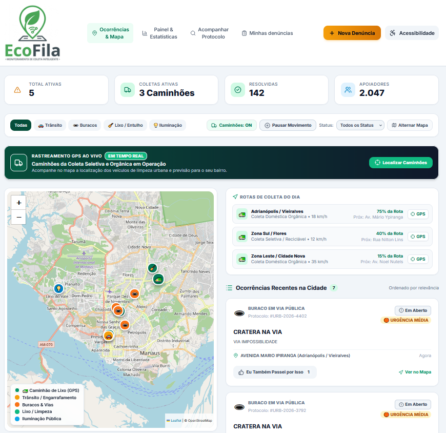
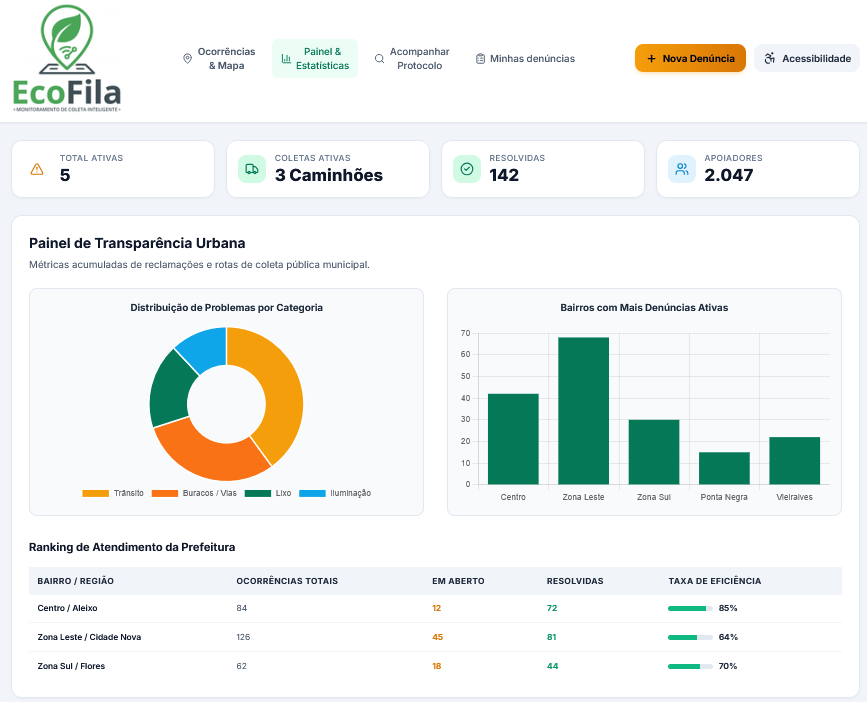
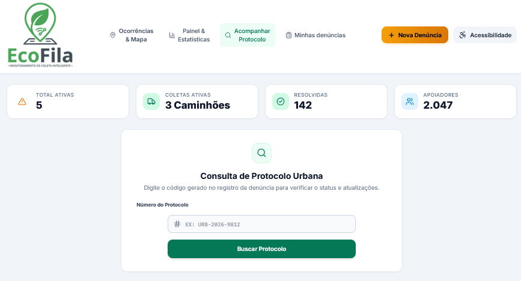
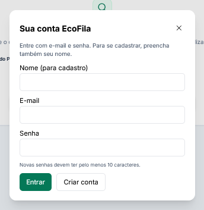

[README.md](https://github.com/user-attachments/files/34777164/README.md)
# 🌿 EcoFila

<div align="center">
  

  **Registre ocorrências urbanas e acompanhe os serviços de coleta em um só lugar.**

  [](http://makeapullrequest.com)

  [Demo ao Vivo](https://ecofila.netlify.app) · [Apresentação HTML](docs/index.html)
</div>

---

## 📋 Sobre o Projeto

O EcoFila é uma plataforma cidadã para registrar e acompanhar problemas urbanos. Ela reúne mapa de ocorrências, consulta de protocolos, estatísticas públicas e ferramentas de atendimento para operadores e administradores.

### ✨ Principais Funcionalidades

- 🗺️ **Mapa de ocorrências** — consulte registros públicos e filtre por categoria e situação.
- 📝 **Registro de denúncias** — informe descrição, endereço e localização; uma imagem pode ser anexada.
- 🔎 **Acompanhamento por protocolo** — consulte a situação de uma ocorrência.
- 👥 **Perfis de acesso** — cidadãos, operadores e administradores têm permissões próprias.

---

## 🎬 Demonstração

### Screenshots

<div align="center">
  Tela Principal
  
  
</div>
<div align="center">
</div>
<div align="center">
</div>
<div align="center">
</div>
      
        
  
  
  
  

---

## 🛠️ Tecnologias Utilizadas

### Frontend

- HTML5, CSS3 e JavaScript (ES6+)
- Tailwind CSS
- Leaflet para mapas
- Chart.js para gráficos
- Lucide para ícones

### Backend

- Node.js 18 ou superior
- API HTTP do Node.js
- MySQL ou MariaDB
- `mysql2` para acesso ao banco
- `dotenv` para variáveis de ambiente

### Ferramentas

- Git e GitHub
- npm
- Visual Studio Code (opcional)

---

## 📖 Como Usar

### Exemplo Básico

O EcoFila é uma aplicação web com servidor e banco de dados. Para iniciar localmente:

```bash
npm install
npm start
```

Depois, abra [http://localhost:3000](http://localhost:3000) no navegador.

### Configuração do Ambiente

1. Execute `models/schema.sql` no MySQL ou MariaDB. O script cria o banco `ecofila_usuarios` e suas tabelas.
2. Copie `.env.example` para `.env` e preencha as configurações locais:

   ```env
   HOST=127.0.0.1
   PORT=3000
   DB_HOST=127.0.0.1
   DB_PORT=3306
   DB_NAME=ecofila_usuarios
   DB_USER=seu_usuario
   DB_PASSWORD=sua_senha
   ADMIN_EMAIL=
   ADMIN_PASSWORD=
   NODE_ENV=development
   ```

3. Preencha `ADMIN_EMAIL` e `ADMIN_PASSWORD` para criar a primeira conta administradora. Cadastros públicos recebem o perfil cidadão; use uma senha forte com pelo menos 10 caracteres.

O arquivo `.env` contém credenciais locais e não deve ser publicado. O `.gitignore` já exclui esse arquivo; envie apenas o `.env.example`, sem valores secretos.

---

## 🗂️ Estrutura de Pastas

```text
EcoFila-com-usuarios/
├── public/
│   └── assets/                 # Logo e imagens do projeto
├── home/
│   ├── index.html              # Página principal
│   ├── script.js               # Mapa, ocorrências e interação
│   ├── styles.css              # Estilos da página principal
│   └── ecofila-config.js       # Configuração visual
├── login/
│   ├── index.html              # Acesso e cadastro
│   ├── script.js               # Comunicação com a autenticação
│   └── styles.css              # Estilos da tela de acesso
├── routes/
│   └── accounts.js             # Contas, sessões e permissões
├── models/
│   └── schema.sql              # Estrutura inicial do banco
├── views/
│   └── 404.html                # Página de endereço não encontrado
├── docs/
│   ├── index.html              # Apresentação HTML do projeto
│   └── screenshots/            # Capturas de tela
├── index.js                    # Servidor web e API
├── .env.example                # Modelo de configuração local
├── .gitignore
├── package.json
└── README.md
```

---

## 🧪 Testes

O `package.json` ainda não define comandos de testes automatizados. A aplicação pode ser conferida manualmente depois de configurar o banco e iniciar o servidor.

---

## 🤝 Contribuindo

Contribuições são bem-vindas:

1. Faça um fork do projeto.
2. Crie uma branch para sua alteração (`git checkout -b feature/minha-alteracao`).
3. Faça as mudanças e registre um commit descritivo.
4. Envie a branch ao seu fork.
5. Abra um Pull Request explicando a alteração.

---

## 📄 Licença

O projeto ainda não contém um arquivo `LICENSE`. A licença precisa ser definida pelos responsáveis pelo EcoFila antes de estabelecer as permissões de reutilização e distribuição.

---

<div align="center">

**🌱 EcoFila — tecnologia para uma cidade mais limpa e participativa.**

</div>
